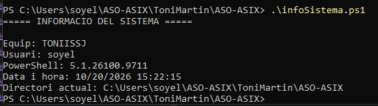
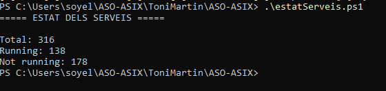
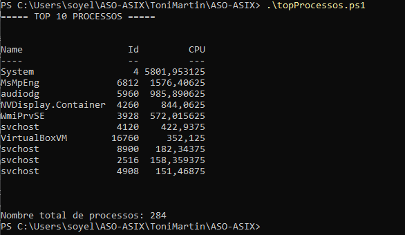
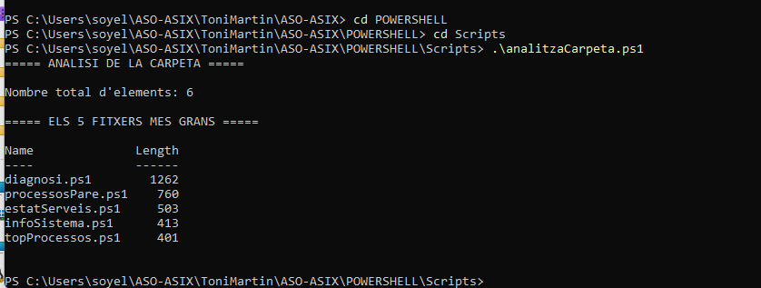
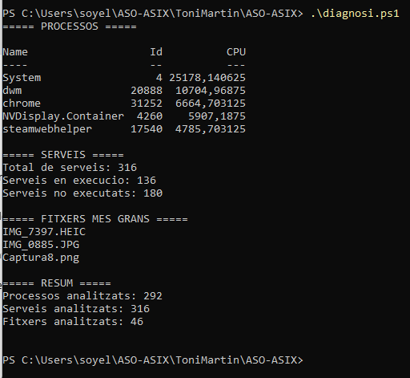
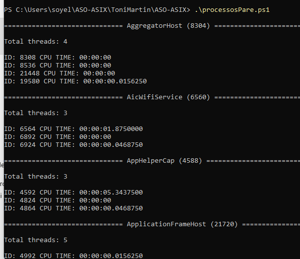

# Scripts PowerShell

L'objectiu d'aquesta pràctica és integrar els conceptes treballats durant la introducció a PowerShell:

- variables;
    
- tipus de dades;
    
- arrays;
    
- pipeline;
    
- `Select-Object`;
    
- `Where-Object`;
    
- propietats dels objectes;
    
- `if`, `elseif`, `else` i `switch`;
    
- `foreach` i `ForEach-Object`;
    
- scripts `.ps1`.
    

> **Important:** abans d'incorporar una ordre al script, és recomanable provar-la directament a la consola de PowerShell.


# 1. Informació bàsica del sistema

Crea un script anomenat:

```
infoSistema.ps1
```

El script ha de mostrar:

- nom de l'equip;
    
- usuari actual;
    
- versió de PowerShell;
    
- data i hora actuals;
    
- directori actual.
    

La sortida ha de ser clara i llegible.

Per exemple:

```
===== INFORMACIÓ DEL SISTEMA =====

Equip: ...
Usuari: ...
PowerShell: ...
Data: ...
Directori actual: ...
```
1. Adjunta el script final.



2. Explica el procés que has seguit o operacions que has executat abans d'obtenir el script final.
>Primer he creat el fitxer estatServeis.ps1 amb Visual Studio Code. He posat una ordre per obtenir tots els serveis de l'ordinador i després he fet servir unes variables per comptar quants estan en execució i quants no. Finalment, he fet que es mostrin els resultats per pantalla i he executat el script amb PowerShell per comprovar que funcionava correctament.

# 2. Estat dels serveis

Crea:

```
estatServeis.ps1
```

El script ha de:

1. obtenir tots els serveis del sistema;
    
2. comptar quants estan en execució;
    
3. comptar quants no estan en execució;
    
4. mostrar el total de serveis;
    
5. mostrar els resultats al final.
    

Exemple:

```
===== ESTAT DELS SERVEIS =====

Total: 230
Running: 95
Not running: 135
```

>Primer he utilitzat Get-Service per obtenir tots els serveis de l'ordinador. Després he guardat els serveis en una variable i he comptat quants n'hi havia en total. 
>Amb Where-Object he filtrat els serveis segons el seu estat: els que estan en execució (Running) i els que no ho estan. Finalment, he utilitzat Write-Host per mostrar els resultats de manera clara.
# 3. Processos amb més consum de CPU

Crea:

```
topProcessos.ps1
```

El script ha de mostrar els **10 processos amb més consum de CPU**.

La sortida ha de mostrar únicament:

```
Name
Id
CPU
```

Després mostra també:

```
Nombre total de processos: ...
```


# 4. Anàlisi de fitxers d'una carpeta

Crea:

```
analitzaCarpeta.ps1
```

El script ha de treballar amb la carpeta des d'on s'executa.

Ha de mostrar:

- nombre total d'elements;
    
- els cinc fitxers més grans;
    
- nom i mida d'aquests fitxers.
    

Investiga les propietats retornades per:

```
Get-ChildItem
```

i utilitza-les per construir el pipeline.

> Tingues en compte que pots trobar tant fitxers com carpetes.



>He creat el fitxer analitzaCarpeta.ps1 amb Visual Studio Code. He utilitzat Get-ChildItem per obtenir tots els elements de la carpeta actual i comptar-los. Després he seleccionat només els fitxers i he utilitzat Sort-Object per ordenar-los segons la seva mida. Finalment, amb Select-Object, he mostrat els cinc fitxers més grans amb el nom i la mida. He executat l'script amb PowerShell per comprovar el resultat.

# 5. Diagnosi bàsica del sistema

Crea:

```
diagnosi.ps1
```
Ha de mostrar almenys quatre apartats.

## Processos

Mostra els cinc processos amb més CPU.

Propietats:

```
Name
Id
CPU
```

## Serveis

Mostra:

```
Total de serveis
Serveis en execució
Serveis no executats
```
## Fitxers

Mostra els tres fitxers més grans de la carpeta actual.

Propietats:

```
Name
Length
```

## Estat final

Al final mostra un petit resum:

```
===== RESUM =====

Processos analitzats: ...
Serveis analitzats: ...
Fitxers analitzats: ...
```

Organitza el script perquè sigui fàcil de llegir.

Pots utilitzar comentaris per separar els diferents blocs:

```
# =====================
# PROCESSOS
# =====================
```



>He creat el fitxer diagnosi.ps1 amb Visual Studio Code i l'he dividit en quatre apartats per tenir el codi més ordenat. Primer he obtingut els cinc processos amb més consum de CPU. Després he comptat els serveis en execució i els que no ho estan. També he ordenat els fitxers de la carpeta actual per mida per mostrar els tres més grans. Finalment, he afegit un resum amb el nombre de processos, serveis i fitxers analitzats.

# 6. Processos pare

Fes un script que per cada procés del sistema ens monstri:
- El nom i id del procés (entre = a l'exemple).
- El total de threads associats al procés
- L'identificador i el temps de processador de cada thread. Es pot donar la circumstància que aquesta última dada no estigui informada o el seu valor sigui 00:00:00.

Exemple de sortida

```text
============================== svchost (2772) ==============================

Total threads: 5

ID: 2776 CPU TIME: 00:00:00.0156250  
ID: 2784 CPU TIME: 00:00:00  
ID: 2788 CPU TIME: 00:00:00.1718750  
ID: 2804 CPU TIME: 00:00:00  
ID: 4864 CPU TIME: 00:00:00

============================== wininit (780) ==============================

Total threads: 1

ID: 784 CPU TIME:

============================== winlogon (852) ==============================

Total threads: 2

ID: 856 CPU TIME: 00:00:00.156250  
ID: 1184 CPU TIME: 00:00:00.0156250

============================== wlms (1828) ==============================

Total threads: 2

ID: 2548 CPU TIME: 00:00:00.0156250  
ID: 3092 CPU TIME: 00:00:00.0156250
```
# Requisits generals

Tots els scripts han de:

1. tenir extensió `.ps1`;
    
2. executar-se amb PowerShell 7;
    
3. utilitzar noms de variables descriptius;
    
4. tenir el codi correctament indentat;
    
5. incloure algun comentari quan sigui necessari;
    
6. evitar codi que no sigui necessari;
    
7. mostrar una sortida comprensible per a l'usuari.
    

Abans de donar un script per acabat:

```
prova cada part a la consola
        ↓
comprova el resultat
        ↓
incorpora-la al script
        ↓
executa el script complet
```



>He creat el fitxer processosPares.ps1 amb Visual Studio Code. He utilitzat Get-Process per obtenir els processos del sistema i foreach per recórrer-los un per un. Després he consultat els threads de cada procés i he mostrat el seu identificador i el temps de CPU. També he utilitzat try/catch per evitar que els errors d'accés a alguns processos interrompin l'execució de l'script.